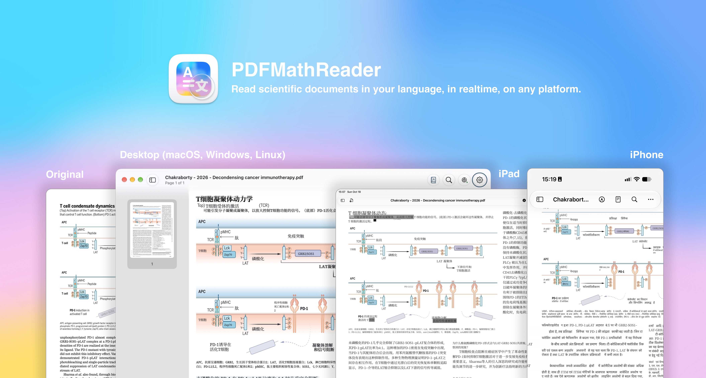

[English](../README.md) · [简体中文](README.zh-CN.md) · [日本語](README.ja.md) · [हिन्दी](README.hi.md) · [Français](README.fr.md) · [Español](README.es.md) · [বাংলা](README.bn.md) · [한국어](README.ko.md)

#  PDFMathReader

[](https://github.com/PDFMathTranslate/PDFMathReader/actions/workflows/electron-build.yml)
<a href="https://github.com/PDFMathTranslate/PDFMathReader/pulls">
</a>
<a href="../LICENSE">
</a>

যেকোনো প্ল্যাটফর্মে, আপনার পছন্দের ভাষায় রিয়েলটাইমে বৈজ্ঞানিক নথি পড়ুন।\
অত্যাধুনিক কৃত্রিম বুদ্ধিমত্তাসমৃদ্ধ [PDFMathTranslate](https://github.com/PDFMathTranslate/PDFMathTranslate)-এর সাহায্যে চালিত।

## বৈশিষ্ট্য

- **লেআউট অক্ষুণ্ণ রেখে অনূদিত নথি পড়ুন**: সূত্র, সারণি এবং অন্যান্য প্রয়োজনীয় বিষয়বস্তু অক্ষুণ্ণ রাখুন।
- **অপেক্ষা না করেই পড়া শুরু করুন**: পড়তে পড়তেই লেআউট শনাক্ত করুন এবং বিষয়বস্তু অনুবাদ করুন।
- **পছন্দের ভাষায় পড়ুন**: ইন্টারফেস, উৎস এবং লক্ষ্য ভাষার বিস্তৃত তালিকা থেকে বেছে নিন, আরও কাস্টমাইজেশনের সুবিধাসহ।
- **পছন্দের অনুবাদ পরিষেবা বেছে নিন**:
  - প্রধান AI প্রদানকারীদের সঙ্গে সংযোগ করুন।
  - OpenAI-সামঞ্জস্যপূর্ণ API-এর মাধ্যমে কাস্টম পরিষেবা ব্যবহার করুন।
  - আমাদের অংশীদারত্বের মাধ্যমে বিনামূল্যে অনুবাদ পান, যাতে বহুভাষিক পড়া আরও সহজলভ্য হয়।
- **পড়ার পাশাপাশি নোট রাখুন**: মূল ও অনূদিত—দুই নথিতেই অংশ হাইলাইট করুন এবং মন্তব্য যোগ করুন।
- **দক্ষভাবে নেভিগেট করুন**:
  - থাম্বনেইল, দ্রুত লিঙ্ক, অনুসন্ধান, আউটলাইন, পৃষ্ঠা নম্বর এবং গ্যালারি ভিউ ব্যবহার করে নথি দেখুন।
  - একাধিক পড়ার লেআউট থেকে বেছে নিন।
  - বিভিন্ন উইন্ডো ও ট্যাবে আপনার কাজ সাজান।
- **পড়ার অভিজ্ঞতা নিজের মতো করে নিন**:
  - বিষয়বাক্য, বৈজ্ঞানিক ফলাফল এবং যুক্তিগত সংযোগ স্বয়ংক্রিয়ভাবে গুরুত্বসহ দেখান।
  - আপনার কাজের ধরন অনুযায়ী অনুবাদের আচরণ সামঞ্জস্য করুন।
  - ফন্ট, আইকন, অ্যাকসেন্ট রং এবং ডার্ক মোড কাস্টমাইজ করুন।
  - লেআউট শনাক্তকরণের গতি ও মানের মধ্যে ভারসাম্য বেছে নিন।
  - মসৃণ স্ক্রলিং চালু করুন।
- **পাঠ্য অনুসরণ করা সহজ করুন**:
  - TF-IDF ওজন ব্যবহার করে স্বতন্ত্র শব্দগুলিকে গুরুত্ব দিন।
  - নির্দিষ্ট দৈর্ঘ্য বা শব্দমূলভিত্তিক গুরুত্বসহ বায়োনিক রিডিং চালু করুন।
- **আপনার কাজের ধারাবাহিকতা বজায় রাখুন**: বিভিন্ন অ্যাপ্লিকেশন ও ডিভাইসের মধ্যে ফাইল শেয়ার ও সম্পাদনা করুন—যেমন, মোবাইল ডিভাইসে পড়া চালিয়ে যেতে AirDrop ব্যবহার করুন।
- **সব প্ল্যাটফর্মে পরিচিত ইন্টারফেস উপভোগ করুন**: macOS, Windows, Linux এবং iOS-এ পড়ুন।

## এক নজরে


## সাম্প্রতিক আপডেট

| তারিখ      | ফিচার                                                                                                                                                                         | অবদানকারী                          |
| ---------- | ----------------------------------------------------------------------------------------------------------------------------------------------------------------------------- | ---------------------------------- |
| 2026-10-17 | [সহযোগী জোড়া লাগানোর কোড আট অক্ষরে সংক্ষিপ্ত করা](https://github.com/PDFMathTranslate/PDFMathReader/commit/5bec25f69a04c0a7cb8811f1faed6ada1a84ba52)                         | [@reycn](https://github.com/reycn) |
| 2026-10-17 | [শুধু মাউসের জন্য মসৃণ স্ক্রল বাধ্যতামূলক করার বিকল্প যোগ করা](https://github.com/PDFMathTranslate/PDFMathReader/commit/b90ebdd8f2311d1060af6882ea20bc1c90404a8f)             | [@reycn](https://github.com/reycn) |
| 2026-10-17 | [Art ও Zotero অ্যাপ আইকন যোগ করা এবং আধুনিক আইকন হালনাগাদ করা](https://github.com/PDFMathTranslate/PDFMathReader/commit/ea8fc7a0787fe67788e6501d5fffba02f6869e76)             | [@reycn](https://github.com/reycn) |
| 2026-10-17 | [উইন্ডো মিনিমাইজ করা থাকলেও সার্ভিস মোডে অনুবাদ চালিয়ে যাওয়া](https://github.com/PDFMathTranslate/PDFMathReader/commit/b77dccaaefd92cfd145781c1b9164b67f02adf2b)            | [@reycn](https://github.com/reycn) |
| 2026-10-16 | [রিমোট ডিভাইসের সঙ্গে কার্নেল শেয়ার করা এবং সংযুক্ত ক্লায়েন্ট দেখানো](https://github.com/PDFMathTranslate/PDFMathReader/commit/6ecb48f5759d1eda69470c54d6236cbbe43b8204)    | [@reycn](https://github.com/reycn) |
| 2026-10-16 | [Cmd+C দিয়ে নির্বাচিত অংশ বা সক্রিয় অ্যানোটেশন কপি করা এবং টোস্ট দেখানো](https://github.com/PDFMathTranslate/PDFMathReader/commit/b9e5cc82b22dee2ae35160df31db9dadace538ac) | [@reycn](https://github.com/reycn) |
| 2026-10-16 | [Appearance সেটিংসে অ্যাপ আইকন বাছাই করার সুবিধা যোগ করা](https://github.com/PDFMathTranslate/PDFMathReader/commit/729755524d0e3cf3464d0ebbf0020e8fb9ddf90d)                  | [@reycn](https://github.com/reycn) |

## দ্রুত শুরু

### ডেস্কটপ

<table width="100%">
  <thead>
    <tr>
      <th width="10%">প্ল্যাটফর্ম</th>
      <th width="30%">macOS</th>
      <th width="30%">Windows</th>
      <th width="30%">Linux</th>
    </tr>
  </thead>
  <tbody>
    <tr>
      <td>স্ক্রিনশট</td>
      <td></td>
      <td></td>
      <td></td>
    </tr>
    <tr>
      <td>ডাউনলোড লিঙ্ক</td>
      <td><a href="https://github.com/PDFMathTranslate/PDFMathReader/actions/workflows/electron-build.yml">GitHub Actions</a></td>
      <td><a href="https://github.com/PDFMathTranslate/PDFMathReader/actions/workflows/electron-build.yml">GitHub Actions</a></td>
      <td><a href="https://github.com/PDFMathTranslate/PDFMathReader/actions/workflows/electron-build.yml">GitHub Actions</a></td>
    </tr>
    <tr>
      <td>ইনস্টলেশন</td>
      <td>macOS ZIP ফাইলটি আনজিপ করুন, <code>PDFMathReader.app</code>-কে <code>/Applications</code>-এ সরিয়ে নিয়ে খুলুন।</td>
      <td><code>PDFMathReader-win32-x64.exe</code>-তে ডাবল-ক্লিক করুন (অথবা 32-বিট Windows-এর জন্য <code>ia32</code> সংস্করণে)।</td>
      <td>আপনার CPU-এর জন্য <code>.tar.gz</code> ফাইলটি আনজিপ করুন, তারপর তার ফোল্ডার থেকে <code>./PDFMathReader</code> চালান।</td>
    </tr>
    <tr>
      <td>অতিরিক্ত নোট</td>
      <td>macOS যদি অ্যাপটিকে “damaged” বলে, তাহলে ডাউনলোডটি বিশ্বস্ত কি না নিশ্চিত করুন, তারপর Terminal-এ <code>sudo xattr -dr</code> <code>com.apple.quarantine</code> <code>/Applications/PDFMathReader.app</code> চালান। অনুরোধ এলে আপনার Mac-এর লগইন পাসওয়ার্ড লিখুন (এটি প্রদর্শিত হবে না), তারপর অ্যাপটি আবার খুলুন।</td>
      <td>পোর্টেবল অ্যাপটির মধ্যে তার runtime রয়েছে। এটি চালু করলে PDF <strong>Open with PDFMathReader</strong> মেনু নিবন্ধিত হয়; executable সরানোর পর অ্যাপটি আবার চালু করুন।</td>
      <td>আপনার CPU architecture-এর সঙ্গে মেলে এমন package বেছে নিন।</td>
    </tr>
  </tbody>
</table>
  *পরীক্ষার জন্য সীমিত ডিভাইস থাকায় Windows এবং Linux-এ সামঞ্জস্য পরীক্ষা পর্যায়ক্রমে করা হয় (অবদানে স্বাগতম)।*

### মোবাইল

- **iOS**: [এই রিপোজিটরিতে দেওয়া হয়েছে](https://github.com/PDFMathTranslate/PDFMathReader-iOS), ডেস্কটপ ক্লায়েন্টের সঙ্গে পরিচিত নকশাসহ
- **Android**: (অবদানে স্বাগতম)

## উন্নয়ন

<details>
<summary>অবদান</summary>

- **সরঞ্জাম:** Bun নির্ভরতা ও স্ক্রিপ্ট পরিচালনা করে; Vue/Vite UI তৈরি করে, আর Electron ও Express Node.js-এ চলে। নির্ভরতা বদলালে `bun.lock` কমিট করুন।
- **পরীক্ষা:** `bun run build` চালান, তারপর `bun run test`; CI স্ক্রিপ্ট `node --test .github/scripts/*.test.*` ব্যবহার করে। আচরণে পরিবর্তনের জন্য নির্দিষ্ট রিগ্রেশন টেস্টের কভারেজ যোগ করুন; [পরীক্ষার অগ্রাধিকার](testing.md) দেখুন।
- **CI:** **কোডের স্টাইল** ফরম্যাটিং ও লিন্ট পরীক্ষা করে; **প্যাকেজিং** macOS, Windows ও Linux-এ অ্যাপ তৈরি এবং চালু করে। **রিলিজ** সংস্করণ বাড়লে সফল ডিফল্ট শাখার প্যাকেজ প্রকাশ করে।
- **স্টাইল:** কমিট করার আগে `bun run style:fix` চালান। Husky স্টেজ করা ফাইল স্বয়ংক্রিয়ভাবে ফরম্যাট ও পরীক্ষা করে এবং অমীমাংসিত ত্রুটি থাকলে বাধা দেয়। Prettier/ESLint JS ও Vue, Ruff Python এবং swift-format Swift যাচাই করে; [সেটআপ ও নিয়ম](code-style.md) দেখুন।

</details>

<details>
<summary>স্থানীয় উন্নয়ন</summary>

[Bun 1.3.14](https://bun.sh/docs/installation) এবং Node.js 22.22.1 বা তার পরের সংস্করণ ইনস্টল করুন। সোর্স থেকে ডেস্কটপ অ্যাপ চালাতে:

```sh
bun install --frozen-lockfile
bun run desktop
```

উপযুক্ত প্ল্যাটফর্মে বিল্ড করুন:

```sh
# macOS (স্বাক্ষর করার পরিচয় প্রয়োজন; স্বাক্ষর এড়াতে --unsigned যোগ করুন)
bun run package:mac
# Windows
bun run package:win
```

ফ্রন্টএন্ড লাইব্রেরিগুলি (Vue, MacVue এবং Fluent UI) বিল্ডের নির্ভরতা: Vite এগুলিকে `dist`-এ অন্তর্ভুক্ত করে। সার্ভার বা Electron-এর প্রধান প্রসেসে ব্যবহৃত Node নির্ভরতাগুলি রানটাইম নির্ভরতা হিসেবেই থাকে। বিল্ড করার আগে `bun install --frozen-lockfile` দিয়ে ইনস্টল করুন; শুধু উৎপাদন-নির্ভরতা ইনস্টল করলে অ্যাপটি বিল্ড বা প্যাকেজ করা যায় না।

About পাতায় GitHub Release-এর আপডেটের অবস্থা, ম্যানুয়াল পরীক্ষা বোতাম এবং স্বয়ংক্রিয় পরীক্ষা সুইচ (ডিফল্টভাবে চালু) রয়েছে। প্যাকেজ করা অ্যাপগুলি চালুর পর এবং প্রতি ছয় ঘণ্টায় প্রয়োজনমতো পরীক্ষা করে; কোনো প্রকাশিত রিলিজ না থাকলে স্বাভাবিক ফাঁকা অবস্থা দেখায়। স্থিতিশীল সংস্করণ ট্যাগগুলিতে `vX.Y.Z` বা `X.Y.Z` ব্যবহার করতে হবে। মিল থাকা রিলিজ অ্যাসেটগুলিতে macOS-এর জন্য `PDFMathReader-<platform>-<arch>.zip`, Windows-এর জন্য `.exe` অথবা Linux-এর জন্য `.tar.gz` থাকে। উপলভ্য আপডেটগুলি সংশ্লিষ্ট ডাউনলোড খোলে, অথবা অ্যাসেট না থাকলে রিলিজ পাতা খোলে; ইনস্টলেশন নিজেকেই করতে হয়।

About পাতা অ্যাপ্লিকেশন, ইনস্টল করা কার্নেল এবং UV সংস্করণ দেখায়। প্রতিটি Vite বিল্ড `dist/build-info.json`-এ প্যাকেজ সংস্করণ এবং সর্বশেষ দশটি প্রচলিত `feat` কমিট (স্কোপযুক্ত ও ভাঙনসৃষ্টিকারী ফিচারসহ) অন্তর্ভুক্ত করে; রিলিজ CI সম্পূর্ণ Git ইতিহাস চেকআউট করে। ইনস্টল করা অ্যাপ Git বা নেটওয়ার্ক অ্যাক্সেস ছাড়াই এই স্ন্যাপশট পড়ে। Git ছাড়া সোর্স আর্কাইভ থেকে তৈরি বিল্ডে আপডেট তালিকা খালি থাকে।

ডিফল্ট Electron প্যাকেজ Express এবং PDF ইউটিলিটিকে ব্যাকএন্ড/প্রধান স্ক্রিপ্টে বান্ডিল করে এবং তাদের লাইসেন্স বজায় রাখে। স্টেজ করা `node_modules`-এ কেবল বাহ্যিক রানটাইম মডিউল কপি করা হয়; নেটিভ PDF Inspector বাইন্ডিং এবং অসমর্থিত নেটিভ টার্গেটের জন্য PDF.js/DOMMatrix ফলব্যাক উপলভ্য থাকে। Electron নিজে এবং প্যাকেজিং টুল বিল্ড টুলচেইন সরবরাহ করে।

ব্রাউজার ডেভেলপমেন্টের জন্য `OPENAI_API_KEY` সেট করুন, `bun run dev` চালান এবং [127.0.0.1:5173](http://127.0.0.1:5173) খুলুন। ডিফল্ট মডেল বদলাতে `OPENAI_MODEL` ব্যবহার করুন। ডেস্কটপ পরিবেশ ভেরিয়েবল `Launch PDFMathReader.command` দিয়ে লোড করা যায়।

```sh
bun run test
bun run build
```

অ্যাপ্লিকেশন স্যুটে 29টি ঝুঁকি-কেন্দ্রিক পরীক্ষা রয়েছে। ধরে রাখা কভারেজ এবং নতুন কেস যোগ করার নীতির জন্য [পরীক্ষার অগ্রাধিকার](testing.md) দেখুন।

</details>

<details>
<summary>বিস্তারিত</summary>

PDFMathReader রিডারের জন্য Vue 3 এবং PDF.js, ডেস্কটপ অ্যাপের জন্য Electron এবং স্থানীয় ব্যাকএন্ডের জন্য Express ব্যবহার করে। Vite ফ্রন্টএন্ড ডেভেলপমেন্ট ও বিল্ড সমর্থন করে; pdf-lib PDF সম্পাদনা পরিচালনা করে।

প্রতিটি ডেস্কটপ উইন্ডোর নিজস্ব রেন্ডারার এবং Electron ইউটিলিটি প্রসেসে চলা ব্যাকএন্ড রয়েছে। প্রধান প্রসেস উইন্ডো, মেনু, ক্রেডেনশিয়াল, সাম্প্রতিক নথি এবং পছন্দ পরিচালনা করে। স্যান্ডবক্স করা প্রিলোড ডেস্কটপ IPC দেয়; ব্যাকএন্ড অনুরোধ `127.0.0.1`-এ প্রমাণীকৃত HTTP ব্যবহার করে।

রেন্ডারিং, লেআউট বিশ্লেষণ এবং অনুবাদ স্বাধীনভাবে চলে। পৃষ্ঠা ও থাম্বনেইল ভার্চুয়ালাইজ করা হয়, PDF.js এবং লেআউট বিশ্লেষণ প্রয়োজনমতো লোড হয়, এবং রেন্ডারিং ক্যাশ সীমিত মেমরি ব্যবহার করে। প্রতিটি নথি একবার তার স্থানীয় ব্যাকএন্ডে আপলোড হয়; পরবর্তী অনুরোধগুলি তার নথি ID ব্যবহার করে। নথি, ভাষা বা কার্নেল বদলালে পুরোনো অনুবাদের কাজ বাতিল হয়।

অনূদিত লেখা নথিগুলির মধ্যে এবং অ্যাপ পুনরায় চালু করার পরেও ক্যাশে থাকে। একই পরিষেবা ও মডেলের অভিন্ন অনুরোধগুলি সংরক্ষিত ফলাফল পুনরায় ব্যবহার করে, গণিত-অনুবাদ কার্নেল থেকে আসা অনুরোধগুলিও এর মধ্যে রয়েছে। ভাষা, প্রম্পট এবং অনুবাদের অন্যান্য বিকল্প ক্যাশ কী-এর অংশ থাকে। একই সময়ে আসা অভিন্ন অনুরোধগুলি একটি পরিষেবা কল ভাগ করে নেয়; ব্যর্থ বা ফাঁকা প্রতিক্রিয়া ক্যাশ করা হয় না।

| সেটিং     | ইঞ্জিন                | আউটপুট                                      |
| --------- | --------------------- | ------------------------------------------- |
| অতি দ্রুত | PDF Inspector         | মূল PDF-এ অনুচ্ছেদের ওভারলে                 |
| দ্রুত     | PDFMathTranslate      | সূত্র সংরক্ষণসহ অনূদিত PDF পৃষ্ঠা           |
| নির্ভুল   | PDFMathTranslate-next | আরও বিস্তারিত টাইপসেটিংসহ অনূদিত PDF পৃষ্ঠা |

পরীক্ষামূলক Jev অনুচ্ছেদ-ধারাবাহিকতা শনাক্তকরণ Ultra fast এবং Fast-এ পাওয়া যায়। Fast অনুবাদ ও টাইপসেটিংয়ের আগে একই কলামের নিশ্চিতভাবে সংলগ্ন খণ্ডগুলো একত্র করে, ফলে সূত্রগুলি যথাস্থানে থাকে। অনিশ্চিত বা ব্যর্থ পরীক্ষা হলে খণ্ডগুলি আলাদা রাখা হয়। এটি চালু করলে আলাদা পৃষ্ঠা ক্যাশ ব্যবহার করা হয়, তাই আগে একত্র না করা আউটপুট পুনরায় তৈরি হয়।

পরীক্ষামূলক: Settings → Experimental → Generate table of contents চালু করলে Edit → Generate Table of Contents যোগ হয়। এটি বুকমার্কহীন নথির জন্য স্থানীয়ভাবে বিষয়বস্তুর তালিকা তৈরি করে এবং Contents সাইডবারে অগ্রগতি দেখায়। এটি মুদ্রিত বিষয়বস্তু পৃষ্ঠা (ডট লিডার এবং ডানদিকে সাজানো পৃষ্ঠা নম্বরসহ) পার্স করে এবং তার পৃষ্ঠা নম্বরগুলিকে প্রকৃত পৃষ্ঠার সঙ্গে মিলিয়ে দেয়; এমন পৃষ্ঠা না থাকলে ফন্টের আকার, নম্বরবিন্যাস ও ফাঁকের ভিত্তিতে শিরোনাম অনুমান করে। কোনো তথ্য কোথাও পাঠানো হয় না। টেক্সট স্তরহীন স্ক্যান করা পৃষ্ঠা সমর্থিত নয়, এবং তৈরি করা বিষয়বস্তু নথির সঙ্গে সংরক্ষিত হয় না।

পরীক্ষামূলক: Precise চাইলে HTTP-এর মাধ্যমে রিমোট [zotero-pdf2zh](https://github.com/guaguastandup/zotero-pdf2zh) সার্ভার ব্যবহার করে অনুবাদ করতে পারে (Settings → Experimental)। PDFMathReader ক্লায়েন্ট হিসেবে ওই সার্ভারের HTTP প্রোটোকল বাস্তবায়ন করে; সার্ভারটি বান্ডিল করা নয় এবং ঐচ্ছিক। সার্ভারের `/health` পরীক্ষা সফল হলেই রিমোট কার্নেল ব্যবহার করা হয়, অন্যথায় স্থানীয় Precise কার্নেল চলে। কোনো API key পাঠানো হয় না; সার্ভার নিজের অনুবাদ পরিষেবা ব্যবহার করে। রিমোট পৃষ্ঠায় পড়ার টেক্সট স্তর থাকে না, এবং নির্বাচিত অনুবাদ পরিষেবা ও গ্লসারিগুলি রিমোটভাবে অনূদিত পৃষ্ঠায় ব্যবহৃত হয় না।

PDF রেন্ডারিং এবং লেআউট বিশ্লেষণ স্থানীয়ভাবেই থাকে। অনুবাদের সময় নথির লেখা OpenAI-এ পাঠানো হয় এবং API খরচ হতে পারে। Fast এবং Precise আলাদা অ্যাপ-পরিচালিত Python পরিবেশে চলে, যেগুলি `uv` দিয়ে ইনস্টল করা হয় এবং ব্যাকএন্ড প্রক্সির মাধ্যমে OpenAI-এ পৌঁছায়। API key রেন্ডারারের বাইরে থাকে।

সংরক্ষিত ডেস্কটপ key Electron `safeStorage` এবং macOS Keychain সুরক্ষা দিয়ে এনক্রিপ্ট করা হয়। সংরক্ষিত key `OPENAI_API_KEY`-কে অগ্রাহ্য করে; এটি মুছে ফেললে পরিবেশের fallback ফিরে আসে। নিরাপদ স্টোরেজ উপলভ্য না থাকলে সংরক্ষণ অক্ষম থাকে।

ডেস্কটপের ডেটা অ্যাপ ডিরেক্টরির `~/Library/Application Support/`-এর অধীনে থাকে: credentials, সাম্প্রতিক নথি, অনুবাদ/লেআউট ক্যাশ এবং kernel environment। ব্রাউজার-ডেভেলপমেন্ট ক্যাশ `.cache/translations/` ব্যবহার করে। ক্যাশ ও অস্থায়ী PDF-এ নথির বিষয়বস্তু থাকতে পারে; শুরুর পাতার **Clear** কেবল সাম্প্রতিক নথির ইতিহাস সরায়।

ব্রাউজার ডেভেলপমেন্টে Express এবং Vite একটি স্বতন্ত্র Node.js প্রসেসে চলে। নেটিভ মেনু, ডেস্কটপ IPC এবং নিরাপদ ডেস্কটপ key সংরক্ষণ কেবল ডেস্কটপ অ্যাপেই উপলভ্য।

</details>

<details>
<summary>সীমাবদ্ধতা</summary>

- **প্ল্যাটফর্ম সমর্থন:** macOS-ই পরীক্ষিত প্ল্যাটফর্ম। Windows এবং Linux-এ প্ল্যাটফর্মভিত্তিক স্টাইল আছে, কিন্তু নেটিভ রানটাইম যাচাই এখনও বাকি। প্যাকেজিং কমান্ড macOS arm64 এবং Windows x64 লক্ষ্য করে।
- **লেআউটের যথার্থতা:** Ultra fast মোড জ্যামিতিক অনুচ্ছেদ গোষ্ঠীবদ্ধকরণ ও টেক্সট ওভারলে ব্যবহার করে। জটিল সারণি, ঘোরানো টেক্সট, অস্বাভাবিক পটভূমি ও দীর্ঘ অনুবাদ মূল টাইপোগ্রাফি ধরে রাখতে নাও পারে। গণিত-কার্নেলের আউটপুট আপস্ট্রিম লেআউট পরিচালনার উপর নির্ভর করে।
- **স্ক্যান করা নথি:** স্ক্যান করা PDF-এর জন্য OCR দরকার, যা এই অ্যাপ বাস্তবায়ন করে না।
- **অনুবাদের প্রয়োজনীয়তা:** অনুবাদের জন্য OpenAI API key এবং নেটওয়ার্ক অ্যাক্সেস প্রয়োজন। Fast এবং Precise-এর জন্য `uv`-এর মাধ্যমে আলাদা গণিত কার্নেল ইনস্টল করতে হয়।
- **পরিসর:** এটি একটি স্থানীয় রিডার ও অনুবাদ অ্যাপ; পূর্ণাঙ্গ PDF সম্পাদনা বা রপ্তানির টুল নয়।
- **যাচাই:** [30টি মূল রিগ্রেশন পরীক্ষা](core-tests.md) ব্যাকএন্ড এবং রিডার-সহায়তা যুক্তি যাচাই করে। মক-প্রোভাইডার পরীক্ষা সরাসরি OpenAI অনুবাদের গুণমান বা API key-এর বৈধতা প্রমাণ করে না।

</details>

## গবেষণাপত্র

এই কাজের মূল কার্নেল [_Proceedings of the 2025 Conference on Empirical Methods in Natural Language Processing: System Demonstrations_](https://aclanthology.org/2025.emnlp-demos.71/) (EMNLP 2025)-এ গৃহীত হয়েছে।

উদ্ধৃতি:

```
@inproceedings{ouyang-etal-2025-pdfmathtranslate,
	    title = "{PDFM}ath{T}ranslate: Scientific Document Translation Preserving Layouts",
	    author = "Ouyang, Rongxin  and
	      Chu, Chang  and
	      Xin, Zhikuang  and
	      Ma, Xiangyao",
	    editor = {Habernal, Ivan  and
	      Schulam, Peter  and
	      Tiedemann, J{\"o}rg},
	    booktitle = "Proceedings of the 2025 Conference on Empirical Methods in Natural Language Processing: System Demonstrations",
	    month = nov,
	    year = "2025",
	    address = "Suzhou, China",
	    publisher = "Association for Computational Linguistics",
	    url = "https://aclanthology.org/2025.emnlp-demos.71/",
	    pages = "918--924",
	    ISBN = "979-8-89176-334-0",
	    abstract = "Language barriers in scientific documents hinder the diffusion and development of science and technologies. However, prior efforts in translating such documents largely overlooked the information in layouts. To bridge the gap, we introduce PDFMathTranslate, the world{'}s first open-source software for translating scientific documents while preserving layouts. Leveraging the most recent advances in large language models and precise layout detection, we contribute to the community with key improvements in precision, flexibility, and efficiency. The work is open-sourced at https://github.com/byaidu/pdfmathtranslate with more than 222k downloads."
	}
```

## লাইসেন্স

PDFMathReader GNU Affero General Public License, version 3-এর অধীনে লাইসেন্সপ্রাপ্ত। সম্পূর্ণ পাঠের জন্য [LICENSE](../LICENSE) দেখুন। নির্ভরতাগুলি তাদের নিজ নিজ লাইসেন্স বজায় রাখে, যার মধ্যে [PDFMathTranslate](https://github.com/PDFMathTranslate/PDFMathTranslate), [PDFMathTranslate-next](https://github.com/PDFMathTranslate-next/PDFMathTranslate-next) এবং [zotero-pdf2zh](https://github.com/guaguastandup/zotero-pdf2zh) (AGPL-3.0, ঐচ্ছিক রিমোট কার্নেল প্রোটোকল) অন্তর্ভুক্ত।

## কৃতজ্ঞতা

সহায়তার জন্য [OpenAI](https://openai.com/), [Anthropic](https://www.anthropic.com/), [Warp](https://www.warp.dev/), [Immersive Translate](https://immersivetranslate.com/) এবং [SiliconFlow](https://siliconflow.cn/)-কে অনেক ধন্যবাদ।
