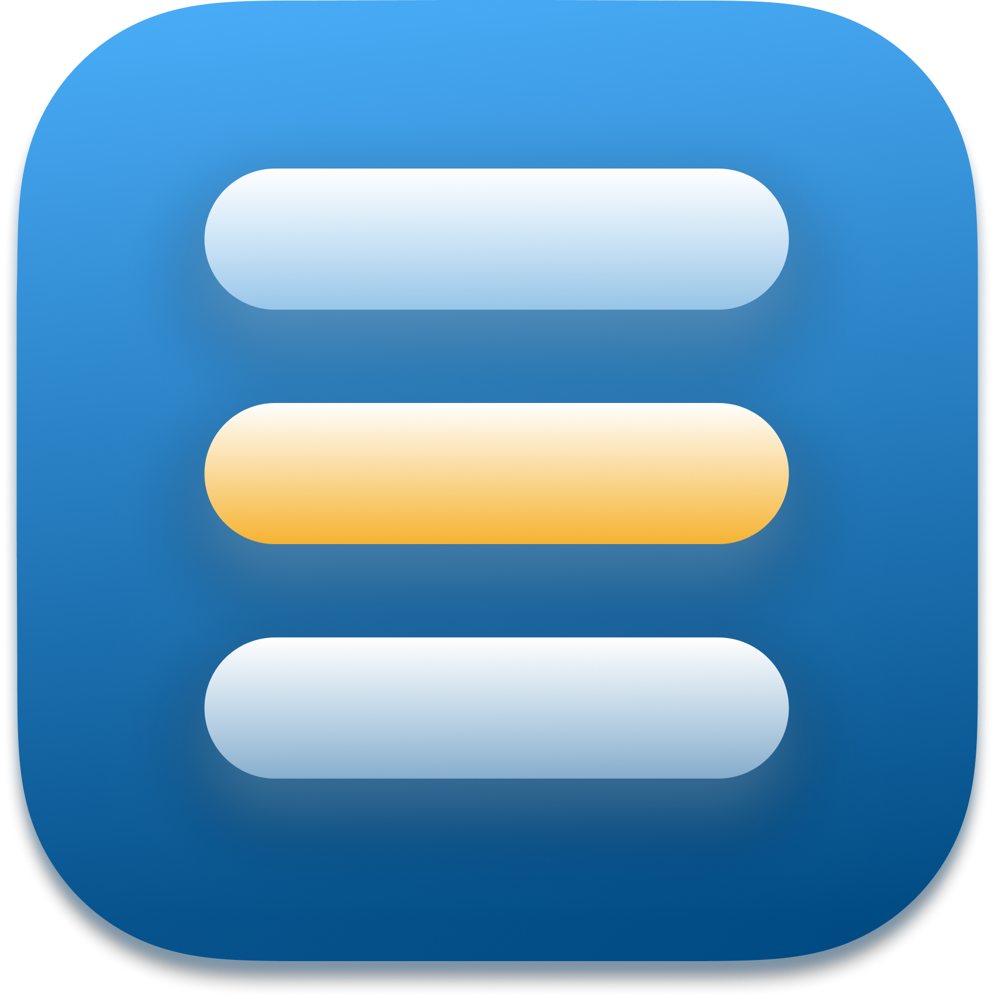
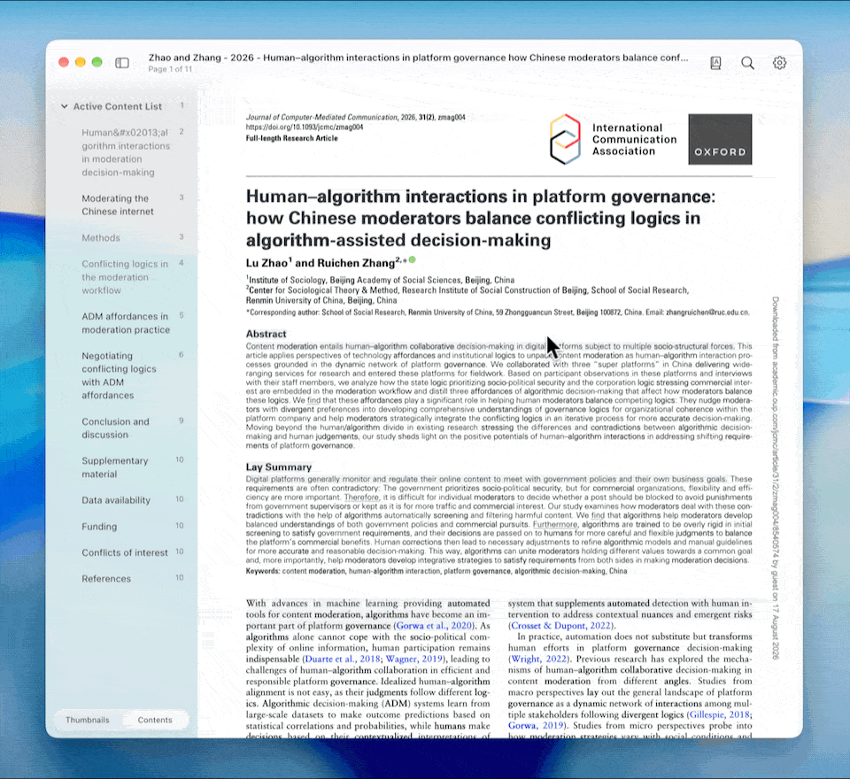
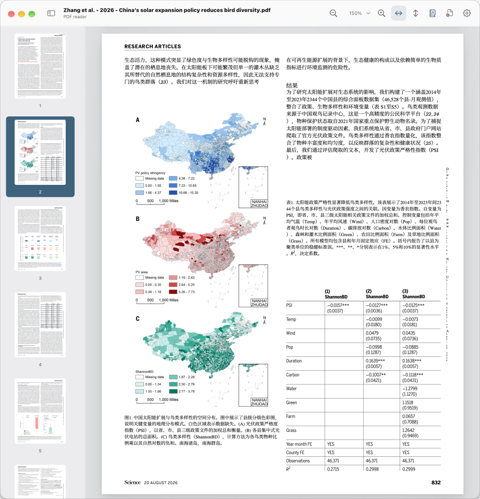
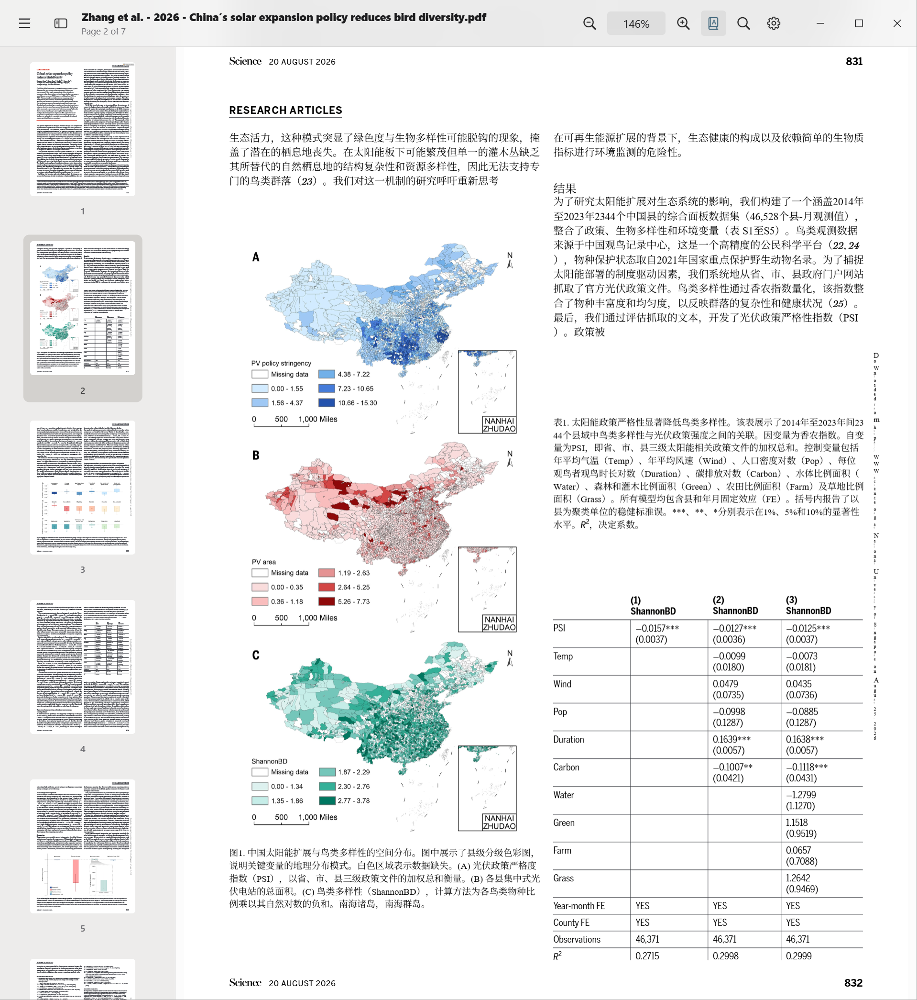
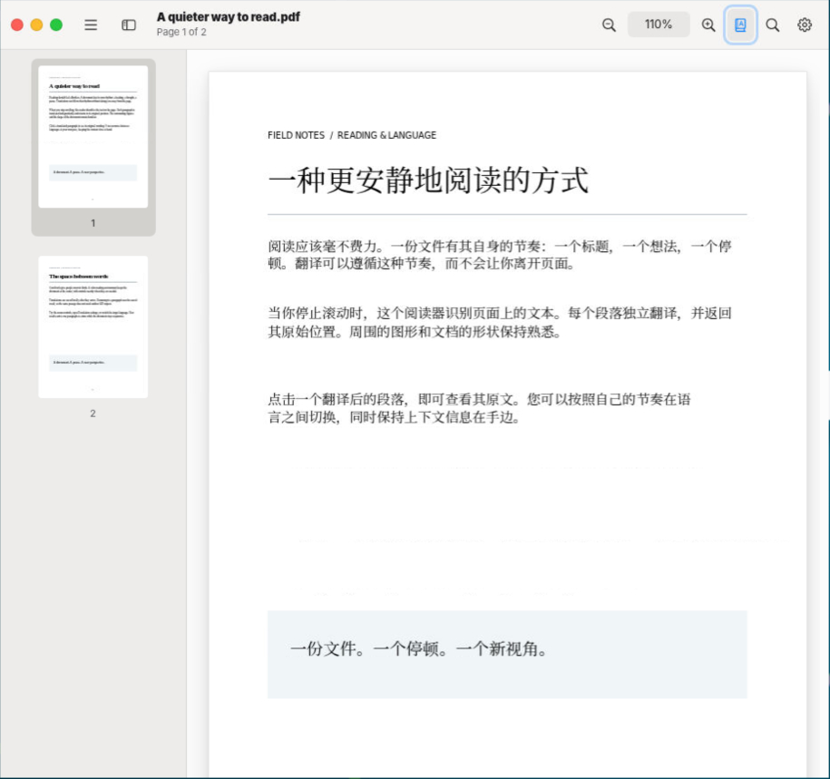

[English](../README.md) · [简体中文](README.zh-CN.md) · [日本語](README.ja.md) · [हिन्दी](README.hi.md) · [Français](README.fr.md) · [Español](README.es.md) · [বাংলা](README.bn.md) · [한국어](README.ko.md)

#  PDFMathReader

[](https://github.com/PDFMathTranslate/PDFMathReader/actions/workflows/electron-build.yml)
<a href="https://github.com/PDFMathTranslate/PDFMathReader/pulls">
</a>
<a href="../LICENSE">
</a>

使用你的语言在任何平台上实时阅读科学文档。<br>
由 [PDFMathTranslate](https://github.com/PDFMathTranslate/PDFMathTranslate) 和前沿人工智能提供支持。



## 功能

- **保留排版阅读翻译后的文档**：保留公式、表格和其他重要内容。
- **无需等待即可开始阅读**：边阅读边检测版面并翻译内容。
- **使用偏好的语言阅读**：从丰富的界面语言、源语言和目标语言中选择，并可进一步自定义。
- **选择偏好的翻译服务**：
  - 连接主要 AI 提供商。
  - 通过 OpenAI 兼容 API 使用自定义服务。
  - 通过合作伙伴获取免费翻译，帮助更多人进行多语言阅读。
- **让笔记伴随阅读**：在原文和译文中高亮段落并添加批注。
- **高效导航**：
  - 通过缩略图、快速链接、搜索、目录、页码和画廊视图浏览文档。
  - 选择多种阅读布局。
  - 在多个窗口和标签页之间管理工作。
- **定制阅读体验**：
  - 自动突出主题句、科学发现和逻辑联系。
  - 根据工作流程调整翻译行为。
  - 自定义字体、图标、强调色和深色模式。
  - 在版面检测速度和质量之间进行平衡。
  - 启用平滑滚动。
- **让文本更易读**：
  - 使用 TF-IDF 加权突出具有辨识度的术语。
  - 使用固定长度或词根强调启用仿生阅读。
- **保持工作流程开放**：在应用和设备之间共享和编辑文件，例如通过 AirDrop 在移动设备上继续阅读。
- **在不同平台享受熟悉的界面**：支持 macOS、Windows、Linux 和 iOS。

## 最近更新

| 日期       | 功能                                                                                                                                           | 贡献者                             |
| ---------- | ---------------------------------------------------------------------------------------------------------------------------------------------- | ---------------------------------- |
| 2026-10-17 | [将伴侣配对码缩短为八位字符](https://github.com/PDFMathTranslate/PDFMathReader/commit/5bec25f69a04c0a7cb8811f1faed6ada1a84ba52)                | [@reycn](https://github.com/reycn) |
| 2026-10-17 | [增加仅鼠标使用时强制平滑滚动的选项](https://github.com/PDFMathTranslate/PDFMathReader/commit/b90ebdd8f2311d1060af6882ea20bc1c90404a8f)        | [@reycn](https://github.com/reycn) |
| 2026-10-17 | [增加 Art 和 Zotero 应用图标并更新现代图标](https://github.com/PDFMathTranslate/PDFMathReader/commit/ea8fc7a0787fe67788e6501d5fffba02f6869e76) | [@reycn](https://github.com/reycn) |
| 2026-10-17 | [窗口最小化时在服务模式下继续翻译](https://github.com/PDFMathTranslate/PDFMathReader/commit/b77dccaaefd92cfd145781c1b9164b67f02adf2b)          | [@reycn](https://github.com/reycn) |
| 2026-10-16 | [与远程设备共享内核并显示已连接的客户端](https://github.com/PDFMathTranslate/PDFMathReader/commit/6ecb48f5759d1eda69470c54d6236cbbe43b8204)    | [@reycn](https://github.com/reycn) |
| 2026-10-16 | [使用 Cmd+C 复制选区或当前批注并显示提示](https://github.com/PDFMathTranslate/PDFMathReader/commit/b9e5cc82b22dee2ae35160df31db9dadace538ac)   | [@reycn](https://github.com/reycn) |
| 2026-10-16 | [在“外观”设置中增加应用图标选择器](https://github.com/PDFMathTranslate/PDFMathReader/commit/729755524d0e3cf3464d0ebbf0020e8fb9ddf90d)          | [@reycn](https://github.com/reycn) |

## 快速开始

### 桌面版

<table width="100%">
  <thead>
    <tr>
      <th width="10%">平台</th>
      <th width="30%">macOS</th>
      <th width="30%">Windows</th>
      <th width="30%">Linux</th>
    </tr>
  </thead>
  <tbody>
    <tr>
      <td>截图</td>
      <td></td>
      <td></td>
      <td></td>
    </tr>
    <tr>
      <td>下载链接</td>
      <td><a href="https://github.com/PDFMathTranslate/PDFMathReader/actions/workflows/electron-build.yml">GitHub Actions</a></td>
      <td><a href="https://github.com/PDFMathTranslate/PDFMathReader/actions/workflows/electron-build.yml">GitHub Actions</a></td>
      <td><a href="https://github.com/PDFMathTranslate/PDFMathReader/actions/workflows/electron-build.yml">GitHub Actions</a></td>
    </tr>
    <tr>
      <td>安装</td>
      <td>解压 macOS ZIP，将 <code>PDFMathReader.app</code> 移到 <code>/Applications</code>，然后打开。</td>
      <td>双击 <code>PDFMathReader-win32-x64.exe</code>（32 位 Windows 使用 <code>ia32</code> 版本）。</td>
      <td>解压与你的 CPU 匹配的 <code>.tar.gz</code>，然后在其文件夹中运行 <code>./PDFMathReader</code>。</td>
    </tr>
    <tr>
      <td>补充说明</td>
      <td>若 macOS 提示应用“已损坏”，确认下载来源可信后，在终端运行 <code>sudo xattr -dr</code> <code>com.apple.quarantine</code> <code>/Applications/PDFMathReader.app</code>。按提示输入 Mac 登录密码（不会显示），然后重新打开应用。</td>
      <td>便携版包含运行时。启动它会注册 PDF 的 <strong>Open with PDFMathReader</strong> 菜单；移动可执行文件后，再次启动它。</td>
      <td>选择与你的 CPU 架构匹配的软件包。</td>
    </tr>
  </tbody>
</table>
  *由于可用于测试的设备有限，Windows 和 Linux 的兼容性检查会定期进行（欢迎贡献）。*

### 移动端

- **iOS**：[本仓库提供](https://github.com/PDFMathTranslate/PDFMathReader-iOS)，与桌面客户端采用熟悉的设计
- **Android**：（欢迎贡献）

## 开发

<details>
<summary>贡献</summary>

- **工具链：** Bun 管理依赖和脚本；Vue/Vite 构建 UI，Electron 和 Express 在 Node.js 上运行。更改依赖时提交 `bun.lock`。
- **测试：**运行 `bun run build`，然后运行 `bun run test`；CI 脚本使用 `node --test .github/scripts/*.test.*`。行为变更应增加有针对性的回归覆盖；参见[测试重点](testing.md)。
- **CI：** **代码风格**检查格式和 lint；**打包**在 macOS、Windows 和 Linux 上构建并启动应用。**发布**在版本增加时发布默认分支构建成功的软件包。
- **代码风格：**提交前运行 `bun run style:fix`。Husky 会自动格式化并检查暂存文件，阻止未解决的错误。Prettier/ESLint 覆盖 JS 和 Vue，Ruff 覆盖 Python，swift-format 覆盖 Swift；参见[设置与规则](code-style.md)。

</details>

<details>
<summary>本地开发</summary>

安装 [Bun 1.3.14](https://bun.sh/docs/installation) 和 Node.js 22.22.1 或更高版本。要从源码运行桌面应用：

```sh
bun install --frozen-lockfile
bun run desktop
```

在匹配的平台上构建：

```sh
# macOS (requires a signing identity; add --unsigned to skip signing)
bun run package:mac
# Windows
bun run package:win
```

前端库（Vue、MacVue 和 Fluent UI）是构建依赖：Vite 会将它们包含在 `dist` 中。服务器或 Electron 主进程使用的 Node 依赖仍是运行时依赖。构建前请使用 `bun install --frozen-lockfile` 安装；仅安装生产依赖无法构建或打包应用。

“关于”页面包含 GitHub Release 更新状态、手动检查按钮和自动检查开关（默认启用）。打包后的应用会在启动后延迟检查，并每六小时检查一次；没有已发布版本时会显示正常的空状态。稳定版本标签必须使用 `vX.Y.Z` 或 `X.Y.Z`。匹配的发布资源使用 `PDFMathReader-<platform>-<arch>.zip`（macOS）、`.exe`（Windows）或 `.tar.gz`（Linux）。有可用更新时会打开匹配的下载；若缺少该资源，则打开发布页面；安装仍需手动完成。

“关于”页面显示应用、已安装内核和 UV 版本。每次 Vite 构建都会将软件包版本和最新 10 个约定式 `feat` 提交（包括带作用域和破坏性特性的提交）写入 `dist/build-info.json`；发布 CI 会检出完整 Git 历史。已安装的应用无需 Git 或网络访问即可读取此快照。从不含 Git 的源代码归档构建时，更新列表为空。

默认 Electron 软件包会将 Express 和 PDF 工具打包进后端/主进程脚本，并保留其许可证。它只会将外部运行时模块复制到暂存的 `node_modules` 中；PDF Inspector 原生绑定，以及不受支持的原生目标所需的 PDF.js/DOMMatrix 回退仍可用。Electron 本身和打包工具由构建工具链提供。

进行浏览器开发时，设置 `OPENAI_API_KEY`，运行 `bun run dev`，然后打开 [127.0.0.1:5173](http://127.0.0.1:5173)。使用 `OPENAI_MODEL` 覆盖默认模型。桌面环境变量可以通过 `Launch PDFMathReader.command` 加载。

```sh
bun run test
bun run build
```

应用套件包含 29 个以风险为重点的测试。有关保留的覆盖范围和添加测试用例的政策，请参见[测试重点](testing.md)。

</details>

<details>
<summary>详情</summary>

PDFMathReader 使用 Vue 3 和 PDF.js 构建阅读器，使用 Electron 构建桌面应用，并使用 Express 提供本地后端。Vite 支持前端开发和构建；pdf-lib 负责 PDF 操作。

每个桌面窗口都有自己的渲染器和运行在 Electron utility process 中的后端。主进程管理窗口、菜单、凭据、最近文档和偏好设置。沙盒化的 preload 提供桌面 IPC；后端请求在 `127.0.0.1` 上使用经过身份验证的 HTTP。

渲染、版面分析和翻译独立运行。页面和缩略图经过虚拟化，PDF.js 和版面分析按需加载，渲染缓存的内存使用有上限。每份文档只上传到本地后端一次；后续请求使用其文档 ID。当文档、语言或内核发生变化时，过时的翻译工作会被取消。

翻译文本会跨文档和应用重启进行缓存。对同一服务和模型的相同请求会复用已保存的结果，包括数学翻译内核发出的请求。语言、提示词和其他翻译选项都会成为缓存键的一部分。并发的相同请求会共享一次服务调用；失败或空响应不会被缓存。

| 设置       | 引擎                  | 输出                        |
| ---------- | --------------------- | --------------------------- |
| Ultra fast | PDF Inspector         | 原始 PDF 上的段落覆盖层     |
| Fast       | PDFMathTranslate      | 保留公式的翻译后 PDF 页面   |
| Precise    | PDFMathTranslate-next | 排版更细致的翻译后 PDF 页面 |

实验性的 Jev 段落续接检测可用于 Ultra fast 和 Fast。Fast 会在翻译和排版前，将同一栏中已确认相邻的片段合并，同时保持公式位置不变。不确定或检查失败时保留独立片段。启用此功能会使用独立的页面缓存，因此会重新生成之前未合并的输出。

实验性：设置 → 实验性 → 生成目录会增加编辑 → 生成目录，该功能会为没有书签的文档在本地建立目录列表，并在目录侧边栏中显示进度。它会解析印刷版目录页（包括点引导线和右对齐的页码），并将其中的页码映射到实际页面；如果没有目录页，则根据字号、编号和间距推断标题。任何内容都不会发送到其他地方。不支持没有文本层的扫描页面，生成的目录也不会随文档保存。

实验性：Precise 还可以通过 HTTP 使用远程 [zotero-pdf2zh](https://github.com/guaguastandup/zotero-pdf2zh) 服务器进行翻译（设置 → 实验性）。PDFMathReader 作为客户端实现该服务器的 HTTP 协议；服务器未随应用打包，为可选项。仅当服务器的 `/health` 检查通过时才使用远程内核，否则运行本地 Precise 内核。不会发送 API 密钥；服务器使用自己的翻译服务。远程页面没有阅读文本层，所选翻译服务和术语表不会用于远程翻译页面。

PDF 渲染和版面分析保持在本地。翻译会将文档文本发送给 OpenAI，可能产生 API 费用。Fast 和 Precise 在通过 `uv` 安装、由应用管理的独立 Python 环境中运行，并通过后端代理访问 OpenAI。API 密钥不会进入渲染器。

保存的桌面密钥使用 Electron `safeStorage` 和 macOS 钥匙串保护进行加密。保存的密钥会覆盖 `OPENAI_API_KEY`；清除它后会恢复使用环境变量回退值。安全存储不可用时，保存功能会被禁用。

桌面数据存储在 `~/Library/Application Support/` 下的应用目录中，包括凭据、最近文档、翻译和版面缓存以及内核环境。浏览器开发缓存使用 `.cache/translations/`。缓存和临时 PDF 可能包含文档内容；起始页上的 **Clear** 只会移除最近文档历史。

浏览器开发模式下，Express 和 Vite 在独立的 Node.js 进程中运行。原生菜单、桌面 IPC 和安全的桌面密钥存储仅在桌面应用中可用。

</details>

<details>
<summary>限制</summary>

- **平台支持：**macOS 是经过测试的平台。Windows 和 Linux 具有平台专用样式，但原生运行时验证仍在等待。打包命令面向 macOS arm64 和 Windows x64。
- **版面保真度：**Ultra fast 使用几何段落分组和文本覆盖层。复杂表格、旋转文本、特殊背景和较长的翻译可能无法保留原始排版。数学内核的输出取决于上游的版面处理。
- **扫描文档：**扫描 PDF 需要 OCR，而本应用尚未实现 OCR。
- **翻译要求：**翻译需要 OpenAI API 密钥和网络访问。Fast 和 Precise 需要通过 `uv` 单独安装数学内核。
- **范围：**这是本地阅读和翻译应用，不是完整的 PDF 编辑或导出工具。
- **验证：**[30 个核心回归测试](core-tests.md)覆盖后端和阅读器支持逻辑。模拟服务提供方的检查无法证明真实的 OpenAI 翻译质量或 API 密钥有效性。

</details>

## 论文

本项目内核的相关工作已被 [_Proceedings of the 2025 Conference on Empirical Methods in Natural Language Processing: System Demonstrations_](https://aclanthology.org/2025.emnlp-demos.71/) 接收（EMNLP 2025）。

引用：

```
@inproceedings{ouyang-etal-2025-pdfmathtranslate,
	    title = "{PDFM}ath{T}ranslate: Scientific Document Translation Preserving Layouts",
	    author = "Ouyang, Rongxin  and
	      Chu, Chang  and
	      Xin, Zhikuang  and
	      Ma, Xiangyao",
	    editor = {Habernal, Ivan  and
	      Schulam, Peter  and
	      Tiedemann, J{\"o}rg},
	    booktitle = "Proceedings of the 2025 Conference on Empirical Methods in Natural Language Processing: System Demonstrations",
	    month = nov,
	    year = "2025",
	    address = "Suzhou, China",
	    publisher = "Association for Computational Linguistics",
	    url = "https://aclanthology.org/2025.emnlp-demos.71/",
	    pages = "918--924",
	    ISBN = "979-8-89176-334-0",
	    abstract = "Language barriers in scientific documents hinder the diffusion and development of science and technologies. However, prior efforts in translating such documents largely overlooked the information in layouts. To bridge the gap, we introduce PDFMathTranslate, the world{'}s first open-source software for translating scientific documents while preserving layouts. Leveraging the most recent advances in large language models and precise layout detection, we contribute to the community with key improvements in precision, flexibility, and efficiency. The work is open-sourced at https://github.com/byaidu/pdfmathtranslate with more than 222k downloads."
	}
```

## 许可证

PDFMathReader 根据 GNU Affero 通用公共许可证第 3 版授权。完整文本请参见 [LICENSE](../LICENSE)。依赖项保留各自的许可证，包括 [PDFMathTranslate](https://github.com/PDFMathTranslate/PDFMathTranslate)、[PDFMathTranslate-next](https://github.com/PDFMathTranslate-next/PDFMathTranslate-next) 和 [zotero-pdf2zh](https://github.com/guaguastandup/zotero-pdf2zh)（AGPL-3.0，可选的远程内核协议）。

## 致谢

感谢 [OpenAI](https://openai.com/)、[Anthropic](https://www.anthropic.com/)、[Warp](https://www.warp.dev/)、[Immersive Translate](https://immersivetranslate.com/) 和 [SiliconFlow](https://siliconflow.cn/) 提供支持。
